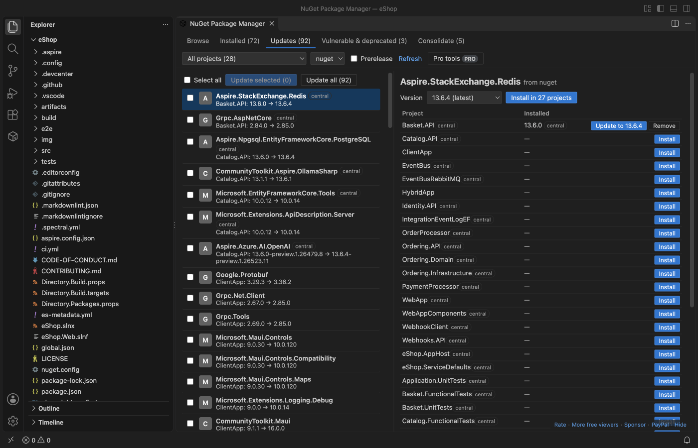

# NuGet Package Manager & NuGet Gallery for VS Code

Browse nuget.org, then install, update and remove NuGet packages in your `.csproj`, `.fsproj` and `.vbproj` files. Central package management (`Directory.Packages.props`), outdated and vulnerable packages across the whole solution, and private feeds from `nuget.config`. Free, no sign-in, no telemetry.

Network: the extension talks only to nuget.org (`api.nuget.org` and its search servers) and to the feeds in your `nuget.config` files, and only after you open the manager. Opening a folder sends nothing.

Not made by or affiliated with Microsoft, the .NET Foundation or NuGet. NuGet is a trademark of its owner.

## What it does

- Projects: it finds every `.csproj`, `.fsproj` and `.vbproj` in all folders of the workspace, and the projects of each `.sln` and `.slnx`. It reads `PackageReference`, `Directory.Packages.props`, `Directory.Build.props` (and the props files they import), `VersionOverride`, `GlobalPackageReference` and versions set through a property such as `$(EFCoreVersion)`.
- Browse: search nuget.org or any v3 feed, with a prerelease switch. Details show versions, downloads, licence, project URL, dependencies per target framework, and the package README.
- Install, update and remove: the extension edits the project XML in place. Formatting, comments, attribute order, the byte order mark and line endings stay as they were. With central package management the version goes to `Directory.Packages.props`. A version set through a property is changed where the property is defined.
- Restore: after each change it runs `dotnet restore` when the .NET SDK is installed, with the output in the NuGet output channel. Without the SDK the change is saved and the message says restore was skipped.
- Updates: the Updates tab lists every outdated package across the solution. Tick some or update all. Version ranges such as `[8.0,9.0)` stay inside the range, and prereleases appear only when you switch them on (or already use one).
- Vulnerable and deprecated: flags from the nuget.org vulnerability data (the same source `dotnet list package --vulnerable` uses) and from the deprecation data of each version, with severity and the advisory link.
- Consolidate: the tab shows packages that are used in more than one version across the projects.
- Private feeds: sources come from every `nuget.config` that applies (the folder, its parents and your user file), including `<clear />` and disabled sources. Azure Artifacts, GitHub Packages and other v3 feeds work with a user name and a personal access token you paste once; it is kept in VS Code's secret storage. A `ClearTextPassword` in `nuget.config` (also `%ENV_VAR%`) is used as is. A 401 shows which feed needs a token.
- `packages.config` projects are listed with a clear message: they are not edited here. Migrate them to `PackageReference` first.

Open it from the NuGet icon in the activity bar, the Manage NuGet Packages button on a project file, or the Command Palette command NuGet: Open NuGet Package Manager.

## Why this one

Measured against what users of the other NuGet extensions asked for (links go to the public issue or review):

| What users asked for | Here |
|---|---|
| Central package management: [pcislo/vscode-nuget-gallery issue 169](https://github.com/pcislo/vscode-nuget-gallery/issues/169) (open since 2 Jan 2026), [aliasadidev/vscode-npm-gui issue 81](https://github.com/aliasadidev/vscode-npm-gui/issues/81) and [issue 42](https://github.com/aliasadidev/vscode-npm-gui/issues/42) (open) | Reads and writes `Directory.Packages.props`, `VersionOverride` and `GlobalPackageReference`. Tested on eShop, Clean Architecture, MediatR, Polly, AutoMapper and Pomelo. |
| Projects outside the first folder: [jmrog/vscode-nuget-package-manager issue 35](https://github.com/jmrog/vscode-nuget-package-manager/issues/35) (open since 2018), and Marketplace reviews of 2 Dec 2021 and 26 Dec 2019 | Every workspace folder and every sub-folder is searched; `bin`, `obj` and `node_modules` are skipped. |
| `nuget.config` and private feeds: [pcislo/vscode-nuget-gallery issue 24](https://github.com/pcislo/vscode-nuget-gallery/issues/24), [jmrog issue 23](https://github.com/jmrog/vscode-nuget-package-manager/issues/23), [aliasadidev issue 47](https://github.com/aliasadidev/vscode-npm-gui/issues/47) | All `nuget.config` levels, `<clear />`, disabled sources, tokens in secret storage, a clear message on 401. |
| Updates that break the project file or need many clicks | Edits change only the version text; the tests check this on 618 references in 150 real project files. One click updates every outdated package of the solution. |

It also works without the .NET SDK for browsing, editing and the outdated view. The same extension is published to Open VSX for Cursor, Windsurf and VSCodium.

## Free and Zovo Pro

Everything above is free and stays free. Two tools for teams are Zovo Pro (USD 19 once, for every Zovo extension). Each can be used 3 times for free first:

- Licence report: the licence of every package of the solution, saved as CSV, for a licence review or a customer.
- Migrate to central package management: moves every version of the solution into one `Directory.Packages.props` in one step, with a diff of every file before anything is written.

Nothing about Pro shows when you open a project. Set `zovoNuget.showProFeatures` to `false` to hide the two tools.

## Settings

| Setting | Default | |
|---|---|---|
| `zovoNuget.includePrerelease` | `false` | Show prerelease versions in search, details and updates |
| `zovoNuget.restoreAfterChange` | `true` | Run `dotnet restore` after a change, when the SDK is installed |
| `zovoNuget.dotnetPath` | empty | Full path of `dotnet` (empty: PATH and `~/.dotnet`) |
| `zovoNuget.showProFeatures` | `true` | Show the two Zovo Pro tools |
| `zovoNuget.askForRating` | `true` | Ask once, after a few good uses, for a rating |
| `zovoNuget.showSupportLinks` | `true` | The small support line at the bottom of the manager |

## Privacy

No account, no telemetry, no analytics. Requests go to nuget.org and to the feeds in your `nuget.config`, only after you open the manager. Tokens stay in VS Code's secret storage and are sent only to the feed they belong to. The vulnerability list from nuget.org is cached in the extension's storage folder.

## Support Zovo

Zovo extensions are free, with no ads and no tracking. They are made by [theluckystrike](https://github.com/theluckystrike) on GitHub. If this one saves you time, you can support the work:

- [Sponsor on GitHub](https://github.com/sponsors/theluckystrike)
- [PayPal](https://www.paypal.com/paypalme/najzzz)
- [Follow theluckystrike on GitHub](https://github.com/theluckystrike)

### Need your format supported?

Open a [format request](https://github.com/theluckystrike/nuget-package-manager-vscode/issues/new?template=format-request.yml) with a sample file, and I reply there whether it can be done. For USD 299 once, through [this GitHub Sponsors tier](https://github.com/sponsors/theluckystrike/sponsorships?tier_id=679995), I add your file format or a missing feature to this extension, with tests, within 7 days.

## More tools by Zovo

- [Hex Viewer & Binary Viewer, Hex Editor (Large Files)](https://marketplace.visualstudio.com/items?itemName=zovo.zovo-hex-viewer) Hex viewer, binary viewer and hex editor for VS Code that opens files of any size (4 GB and more) in under a second. Insert and delete bytes, compare two files byte by byte, go to offset, find hex or text, a data inspector, copy as C array or base64. Free, works offline.
- [XLSX Viewer & CSV Preview for Excel, XLS & Parquet](https://marketplace.visualstudio.com/items?itemName=zovo.table-viewer-vscode) opens CSV, TSV, Excel and Parquet files as a sortable, filterable table.
- [Large JSON Viewer, JSON Browser & JSON Tree](https://marketplace.visualstudio.com/items?itemName=zovo.zovo-json-tree-viewer) shows large JSON files as a searchable tree, copies JSONPath and turns arrays of objects into a table.
- [JSONL Viewer, Large JSONL Table & NDJSON Viewer](https://marketplace.visualstudio.com/items?itemName=zovo.zovo-jsonl-viewer) opens JSONL and NDJSON files as a table, as records or as a chat view.
- [SQLite Viewer & SQLite3 DB File Browser, Database Explorer](https://marketplace.visualstudio.com/items?itemName=zovo.sqlite-table-viewer) browses SQLite tables read-only and runs SELECT queries.

See [all Zovo extensions on the Marketplace](https://marketplace.visualstudio.com/publishers/zovo).

## More from zovo

- [All free zovo VS Code extensions](https://marketplace.visualstudio.com/publishers/zovo) — file viewers, database clients, formatters. Offline, no telemetry, no sign-up.
- [Full MCP server catalogue](https://theluckystrike.github.io/mcp/) — local-first MCP servers for back-office work: invoices, VAT, PDFs, spreadsheets, payroll.
- [Hosted no-install MCP endpoints](https://mcp.zovo.one) — paste a URL in Claude / Cursor, nothing to install.
